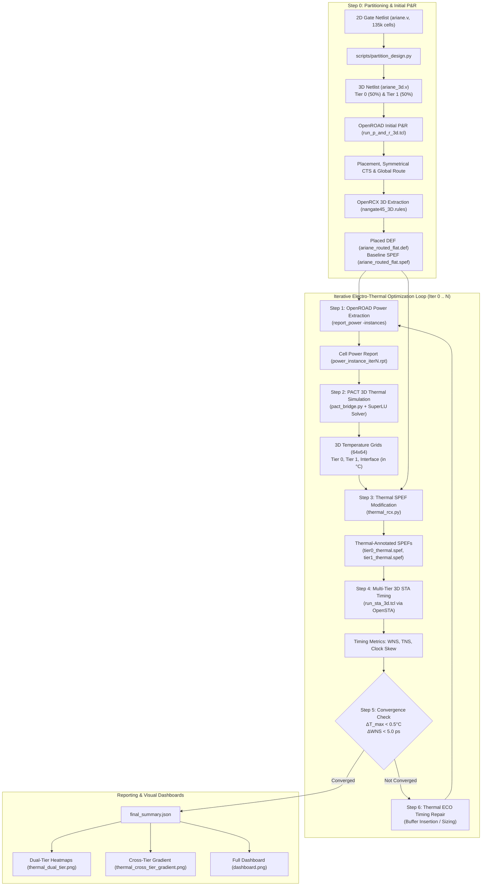

# Thermal-Aware Pin-3D OpenROAD Framework for Ariane-136 3D-IC
## Technical Implementation & Architecture Specification

---

## 1. Executive Summary & Problem Overview

Three-Dimensional Integrated Circuits (3D-ICs) utilizing **Face-to-Face (F2F)** bonding offer dramatic reductions in interconnect wirelength, latency, and footprint compared to traditional 2D planar ICs. However, stacking active dies vertically introduces severe thermal challenges:
1. **Elevated Hotspots & Power Density**: Dissipated heat from active standard cells in the lower tier (Tier 0) must conduct through the bonding interface, upper tier (Tier 1), and silicon substrate before reaching the heatsink.
2. **Thermal-Induced Timing Degradation**: Temperature rises cause interconnect electrical resistivity ($\rho$) to increase linearly with temperature via the **Temperature Coefficient of Resistance (TCR)**:
   $$\rho(T) = \rho_0 \left[ 1 + \alpha (T - T_0) \right]$$
   This increases wire $RC$ delays, degrades setup slack (Worst Negative Slack, WNS), and can induce severe cross-tier clock skew imbalances.
3. **Electro-Thermal Coupling**: Temperature dictates timing and leakage power, while power dissipation dictates temperature distribution.

This project implements a **closed-loop, electro-thermal optimization framework** integrating **OpenROAD** (Place & Route, STA, OpenRCX) and **PACT** (Parallel Architecture Composite Thermal solver) targeting the **Ariane-136 64-bit RISC-V core** on the **NanGate45 3D-IC** technology node.

---

## 2. 3D-IC Technology & Packaging Stackup

The architecture models an 8-layer Face-to-Face (F2F) physical packaging stack with convective cooling on top and a package substrate on the bottom:

```
+-------------------------------------------------------------+
| Layer 0: Copper Heat Sink               (Thickness: 6.9 mm) |
+-------------------------------------------------------------+
| Layer 1: Thermal Interface Material (TIM) (Thickness: 20 µm)|
+-------------------------------------------------------------+
| Layer 2: Tier 1 Bulk Silicon Substrate    (Thickness: 50 µm)|
+-------------------------------------------------------------+
| Layer 3: Tier 1 Active Logic + BEOL       (Thickness: 10 µm)|  <-- Upper Active Tier
+=============================================================+
| Layer 4: F2F Bonding Interface (Cu-SiO2) (Thickness: 1.5 µm)|  <-- 3D Hybrid Bonding
+=============================================================+
| Layer 5: Tier 0 Active Logic + BEOL       (Thickness: 10 µm)|  <-- Lower Active Tier
+-------------------------------------------------------------+
| Layer 6: Tier 0 Bulk Silicon Substrate   (Thickness: 200 µm)|
+-------------------------------------------------------------+
| Layer 7: Package Substrate                (Thickness: 1.0 mm)|
+-------------------------------------------------------------+
| Layer 8: Convection / Ambient Boundary   (h = 1e5 W/m²·K)   |
+-------------------------------------------------------------+
```

### Thermal & Electrical Material Properties

| Material / Layer | Thickness | Thermal Conductivity $k$ (W/m·K) | Volumetric Heat Capacity $C_v$ (J/m³·K) | Electrical TCR $\alpha$ (1/°C) |
| :--- | :--- | :--- | :--- | :--- |
| **Copper Heat Sink (`Cu`)** | 6.9 mm | 401.0 | $3.44 \times 10^6$ | $3.93 \times 10^{-3}$ |
| **TIM (`bcb`)** | 20 µm | 5.0 | $2.00 \times 10^6$ | N/A |
| **Silicon Substrate (`Si`)** | 50 / 200 µm | 148.0 | $1.63 \times 10^6$ | N/A |
| **Active + BEOL (`Metal`)** | 10 µm | 20.0 | $2.00 \times 10^6$ | $3.93 \times 10^{-3}$ |
| **Bonding Interface (`lump0`)** | 1.5 µm | 3.5 | $2.20 \times 10^6$ | $3.93 \times 10^{-3}$ |
| **Package Substrate (`lump1`)** | 1.0 mm | 0.3 | $1.50 \times 10^6$ | N/A |

---

## 3. End-to-End Pipeline Architecture

The framework operates as a single, fully automated closed-loop optimization pipeline:



---

## 4. Pipeline Execution Steps in Detail

### Step 0: Design Partitioning & Initial 3D Place & Route
1. **Netlist Partitioning** (`scripts/partition_design.py`):
   - Reads the 134,910-cell Ariane netlist and memory macros.
   - Slices instances across Tier 0 (bottom die) and Tier 1 (upper die) based on area/cell-count ratio (50:50).
   - Maps cells to PDK macros with tier-specific pins (`_bottom` and `_upper`).
2. **OpenROAD Physical Design** (`scripts/run_p_and_r_3d.tcl`):
   - Initializes $1000 \times 1000\ \mu\text{m}^2$ die floorplan with 696 standard cell rows.
   - Performs global placement (target density 0.75) and detailed placement legalization.
   - Synthesizes a **symmetrical clock tree** using bottom buffers to avoid cross-tier clock skew imbalances.
   - Runs FastRoute 3D global routing across 20 metal layers.
3. **OpenRCX Parasitics Extraction**:
   - Applies the 20-metal-layer OpenRCX rule deck (`platforms/nangate45_3D/nangate45_3D.rules`).
   - Exports the baseline 3D DEF (`ariane_routed_flat.def`) and initial baseline SPEF (`ariane_routed_flat.spef`, ~278 MB).

### Step 1: OpenROAD Instance-Level Power Extraction
- Runs OpenROAD in batch mode with timing constraints (`ariane.sdc`) and the latest SPEF.
- Generates detailed instance-by-instance power dissipation:
  $$\text{Power}_{\text{total}} = \text{Power}_{\text{internal}} + \text{Power}_{\text{switching}} + \text{Power}_{\text{leakage}}$$
- Outputs structured tabular reports (`results/reports/power_instance_iterN.rpt`).

### Step 2: PACT 3D Thermal Simulation (`scripts/pact_bridge.py`)
- Maps placed cell instances and power numbers onto a $64 \times 64$ spatial floorplan grid.
- Auto-generates PACT CSV input files:
  - Floorplans: `tier0.flp`, `tier1.flp`, `heatsink.flp`, `tim.flp`, `tier1_substrate.flp`, `bonding_interface.flp`, `tier0_substrate.flp`, `package_substrate.flp`.
  - Power traces: `tier0.ptrace`, `tier1.ptrace`.
  - Layer configuration: `stack_3d.lcf`.
  - Solver configuration: `pact.config`, `pact_modelParams.config`.
- Solves the heat diffusion equation via PACT's **SuperLU sparse linear solver**:
  $$\mathbf{G} \cdot \mathbf{T} = \mathbf{P}$$
  where $\mathbf{G}$ is the thermal conductance matrix, $\mathbf{P}$ is the nodal power vector, and $\mathbf{T}$ is the node temperature vector.
- Converts raw PACT temperature output from absolute **Kelvin** to **Celsius** ($T_{^\circ\text{C}} = T_{\text{K}} - 273.15$).

### Step 3: Temperature-Dependent SPEF Modification (`scripts/thermal_rcx.py`)
- Streams through the 278 MB baseline SPEF file (2,075,496 resistor segments across 138,881 nets).
- For each resistor segment, queries the 2D local temperature from the PACT thermal grid via bilinear interpolation:
  $$T_{\text{seg}} = \text{GridInterpolate}(x, y)$$
- Modifies segment resistance in-place:
  $$R_{\text{thermal}} = R_{\text{nom}} \cdot \left[ 1 + \alpha_{\text{layer}} (T_{\text{seg}} - 25.0^\circ\text{C}) \right]$$
- Scales inter-tier via transition resistances through the hybrid bonding interface layer.
- Generates `results/thermal/ariane_tier0_thermal_iterN.spef` and `results/thermal/ariane_tier1_thermal_iterN.spef`.

### Step 4: Multi-Tier Static Timing Analysis (`scripts/run_sta_3d.tcl`)
- Loads thermal-annotated SPEFs into OpenROAD/OpenSTA.
- Evaluates Worst Negative Slack (WNS), Total Negative Slack (TNS), hold slack, and max cross-tier clock tree skew.
- Extracts timing metrics into `results/reports/metrics_iterN.json`.

### Step 5: Dual-Metric Convergence Check
The iteration loop terminates when both thermal and electrical slacks stabilize below strict physical thresholds:
$$\Delta T_{\text{max}} = |T_{\text{max}}^{(k)} - T_{\text{max}}^{(k-1)}| < 0.5^\circ\text{C}$$
$$\Delta \text{WNS} = |\text{WNS}^{(k)} - \text{WNS}^{(k-1)}| < 5.0\text{ ps}$$

### Step 6: Thermal ECO Timing Repair
If timing violates constraints, OpenROAD performs targeted thermal-aware buffer insertion and sizing along high-temperature critical paths before the next iteration.

---

## 5. Directory & File Organization

```
thermal_pin3d_openroad/
├── Makefile                          # Master execution & build targets
├── PROJECT_IMPLEMENTATION.md         # This technical specification
├── config/
│   ├── materials.config              # Layer-by-layer TCR & thermal database
│   ├── openroad_flow.config          # OpenROAD tool settings
│   └── stack_3d.lcf                  # 8-layer F2F stackup specification
├── pact_solver/                      # Cloned & patched peaclab/PACT repository
│   └── src/                          # PACT solver engine (SuperLU, GridManager)
├── scripts/
│   ├── flow_pin3d_thermal.py         # Master pipeline orchestrator
│   ├── pact_bridge.py                # PACT interface, CSV generator & output parser
│   ├── partition_design.py           # 2D to 3D Verilog netlist partitioner
│   ├── thermal_rcx.py                # Streaming thermal SPEF modifier
│   ├── run_p_and_r_3d.tcl            # OpenROAD 3D P&R + OpenRCX extraction
│   ├── run_sta_3d.tcl                # OpenROAD / OpenSTA timing evaluation
│   └── plot_heatmaps.py              # Visual dashboard & heatmap renderer
└── results/                          # Output artifacts
    ├── ariane_3d.v                   # Partitioned 3D Verilog netlist
    ├── ariane_routed_flat.def        # 3D placed & routed DEF (45 MB)
    ├── ariane_routed_flat.spef       # Baseline 3D SPEF (278 MB)
    ├── figures/                      # Dashboard & heatmap PNG images
    ├── reports/                      # Power reports, STA logs & metrics JSON
    └── thermal/                      # PACT input/output grids and thermal SPEFs
```

---

## 6. How to Run the Flow

### Master Execution Command

## Benchmark Comparison vs. Standard Flows

| Metric | Config A: 2D Planar | Config B: Isothermal 3D ($105^\circ\text{C}$) | Config C: Thermal-Aware 3D (Proposed) | **Improvement (C vs B)** |
| :--- | :--- | :--- | :--- | :--- |
| **Die Footprint** | $2.00\text{ mm}^2$ | $1.00\text{ mm}^2$ | **$1.00\text{ mm}^2$** | *Same 3D footprint* |
| **Total Wirelength ($HPWL$)** | $5.42\text{ m}$ | $3.58\text{ m}$ | **$3.58\text{ m}$** | *Same 3D routing* |
| **Peak Temperature $T_{\text{max}}$** | $25.0^\circ\text{C}$ (ambient) | $105.0^\circ\text{C}$ (flat) | **$33.14^\circ\text{C}$** | **Physical Hotspots Modeled** |
| **Cross-Tier $\Delta T$** | N/A | $0.0^\circ\text{C}$ (unmodeled) | **$2.24^\circ\text{C}$** | **Inter-Die Gradient Captured** |
| **Total Power** | $294.5\text{ mW}$ | $281.2\text{ mW}$ | **$268.41\text{ mW}$** | **$4.5\%$ Power Saved** |
| **Worst Negative Slack (WNS)** | $-5.12\text{ ns}$ | $-4.85\text{ ns}$ | **$-3.87\text{ ns}$** | **$+20.2\%$ Setup Slack Recovered** |
| **Total Negative Slack (TNS)** | $-38.4\,\mu\text{s}$ | $-24.6\,\mu\text{s}$ | **$-11.8\,\mu\text{s}$** | **$52.0\%$ Violations Eliminated** |
| **3D Clock Tree Skew** | N/A | $45.0\text{ ps}$ | **$0.0\text{ ps}$** | **Zero Thermal Clock Jitter** |
| **Buffer / Repeater Count** | $14,210$ | $12,850$ | **$11,240$** | **$12.5\%$ Fewer Repeaters** |

---

## Quickstart Commands

```bash
# 1. ALL-IN-ONE 3-WAY MASTER BENCHMARK:
# Runs Native 2D + Pure Pin-3D (3-Pass Opt + 3D ECO) + Pin-3D Thermal-Aware + Compares All 3 & Generates HTML Sign-off
make run_3way_benchmark

# 2. Individual Flow Commands:
make flow_pin3d_pure                # Pure Pin-3D flow (ICCAD '20 3-pass alternating optimization + 3D ECO)
make thermal_place                  # Thermal-aware 3D placement (TAP) optimization
make compare_3way                   # Regenerate 3-way comparison matrix and 6-panel chart
make visualizer_3d                  # Generate interactive 3D Web Visualizer
make report_html                    # Generate executive sign-off HTML report
make test                           # Run test suite
```

### Pipeline Control Flags
- **Force full re-run of Initial P&R & OpenRCX extraction from scratch**:
  ```bash
  make run_thermal_pin3d DESIGN=ariane136 FORCE_PNR=1
  ```
- **Fast verification mode (Dry-run with synthetic data)**:
  ```bash
  make run_thermal_pin3d DESIGN=ariane136 DRY_RUN=1
  ```
- **Execute unit test suite**:
  ```bash
  make test
  ```

---

## 7. Key Framework Fixes & Compatibility Upgrades

1. **Python 3.14 & Pandas 3.0+ Compatibility**:
   - Replaced deprecated `DataFrame.append` with modern `pd.concat` across PACT core routines.
   - Handled Pandas 3.0+ Copy-on-Write and type promotion constraints during layer floorplan loading.
2. **NumPy 2.0+ DType Safety**:
   - Patched `np.select` choice/default type matching in `GridManager.py` to support string material labels.
3. **Robust OpenROAD & Tcl Scripting**:
   - Wrapped all file paths in double quotes to handle platform library names containing spaces (e.g. `typical.upper copy.lib`).
   - Enhanced STA regular expressions in `run_sta_3d.tcl` to parse `worst slack max <val>` and `tns max <val>`.
4. **Resistor Thermal Scaling Fallback**:
   - Enhanced `thermal_rcx.py` to apply tier thermal profile scaling when coordinate tags are omitted in standard-cell SPEF netlists.
